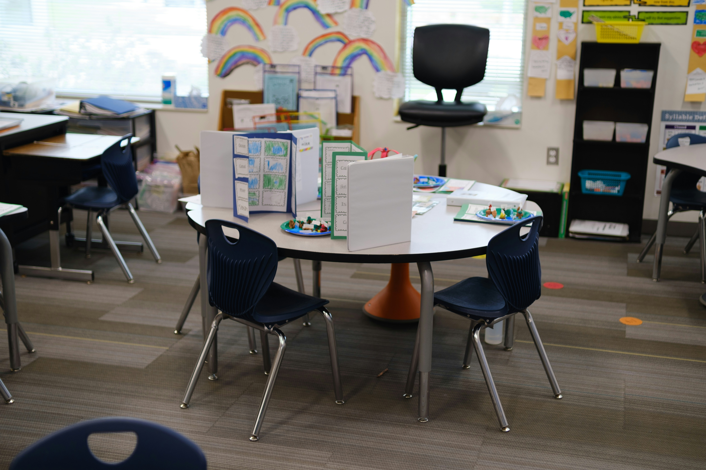

# CATCHMENT

*Photo by [Far Chinberdiev](https://unsplash.com/@fardevio) on [Unsplash](https://unsplash.com/photos/classroom-table-with-blue-chairs-K1-JVKnKGZc), free to use under the [Unsplash License](https://unsplash.com/license).*

School roll capacity pressure in the **Bay of Plenty-Waiariki** region, New
Zealand, a SQL Server + Power BI learning project built on real NZ Ministry
of Education (MoE) data, end to end: raw CSVs &rarr; staging tables &rarr;
star schema &rarr; window-function analytics &rarr; a published dashboard.

**[View the live dashboard &rarr;](docs/dashboard.html)**

## The question

Which schools in Bay of Plenty-Waiariki are under roll-growth pressure, and
how has that pressure shifted since 2010? The region's school-age population
has grown unevenly: some territorial authorities (Tauranga City, Western Bay
of Plenty) are adding rolls fast, others are flat or declining. Schools
built decades ago don't necessarily have room to absorb that growth.

## What's here

| Path | What it is |
|---|---|
| `sql/staging_*.sql` | Raw 1:1 loads of each MoE source CSV, no transformation |
| `sql/star_schema.sql` | The dimensional model: `dim_school`, `dim_area`, `dim_year`, `dim_year_level`, `dim_ethnicity`, `fact_roll`, `school_status_history` |
| `sql/analysis_01` &ndash; `06` | The six window-function analyses (one file each, documented) |
| `docs/dashboard.html` | A self-contained HTML dashboard built from the six analyses |
| `docs/METHODOLOGY.md` | Full build log: design decisions, bugs found and fixed, data traps and how they were handled |
| `docs/data_sources.md` | Exact source URLs and download dates for every MoE file used |
| `docs/data_model.md` | Star schema design notes |
| `CATCHMENT_plan_del_proyecto.md` | Original project plan (research question, the six analyses, the known data traps, week-by-week scope) |

Raw and processed data files are gitignored; see `docs/data_sources.md` to
re-download them; everything downstream is reproducible from the scripts in
`sql/`.

## The six analyses

1. **Year-over-year variation** per school (`LAG()` over year)
2. **Cohort progression**: Year 5 2020 &rarr; Year 6 2021 retention/leakage per school
3. **Ranking within each territorial authority** by latest growth (`RANK()`)
4. **3-year moving average** of roll, to smooth year-to-year noise
5. **Each school's share** of its TA's total roll over time
6. **Capacity pressure signal**: current roll vs. each school's own historical maximum (a **proxy**, not a real capacity measurement; the MoE dataset doesn't publish classroom capacity)

## Key data traps handled

- **Ethnicity counting.** The MoE roll-by-year-level source counts ethnicity
  as *total response* (a student can appear under more than one ethnic
  group), not *prioritised*. Summing across ethnicity overstates the real
  roll by roughly 2x (confirmed empirically, not assumed). All five
  school-total analyses use the un-split roll source instead; only cohort
  progression (which needs the year-level breakdown) carries the ~2x
  inflation, and it's labelled as such.
- **Capacity is a proxy, always labelled.** "Capacity pressure" here means
  *current roll at/above its own historical peak*, never presented as real
  classroom capacity.
- **Decile &rarr; Equity Index.** The MoE switched funding-equity metrics in
  2023 (decile is `NULL` from 2023 onward); not mixed across the boundary.
- **Mergers/closures vs. genuine decline.** A roll dropping to zero can mean
  a school merged or closed, not that it emptied. This is reconciled against
  `school_status_history` before calling anything a "decline".
- Full detail on every trap, bug, and fix is in `docs/METHODOLOGY.md`.

## Stack

SQL Server (star schema + window-function SQL) &middot; Power BI (planned,
see `power_bi/`) &middot; a hand-rolled HTML/SVG dashboard for the published
view (`docs/dashboard.html`).

## Status

Star schema and all six analyses are built and verified against the live
database. Dashboard is published. Power BI report (`power_bi/`) and final
write-up are still to come; see `CATCHMENT_plan_del_proyecto.md` for the
remaining scope.

---

Data Analyst &middot; [gabrielaolivera.nz](https://gabrielaolivera.nz/) &middot; [LinkedIn](https://www.linkedin.com/in/gabriela-olivera-nz/) &middot; [hello@gabrielaolivera.nz](mailto:hello@gabrielaolivera.nz)
